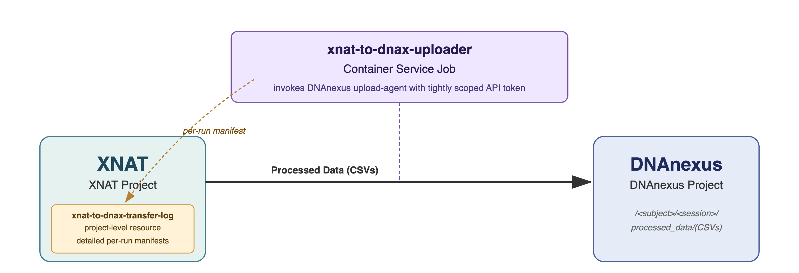

# xnat-to-dnax-uploader v1.0.0

XNAT Container Service command that exports processed data (CSV) from an XNAT session to a DNAnexus project. Uses the DNAnexus **upload-agent** to push the CSV directly to the destination project, and writes a per-run manifest back to the source XNAT project for a persistent audit trail.



## Repo Structure

```
xnat-to-dnax-uploader/
├── command.json                  # XNAT Container Service command definition
├── Dockerfile                    # Debian slim + DNAnexus upload-agent + wrapper
├── wrapper.py                    # Container entrypoint
└── docs/
    └── architecture-v1.0.0.png   # Service architecture diagram
```

## How It Works

1. XNAT CS mounts the session archive read-only at `/input`. The container locates the target CSV inside the session's RESOURCES.
2. On launch, XNAT project ID, subject label, and session label are auto-extracted from the session's XNAT metadata via Container Service derived inputs.
3. Uploads the CSV to the destination DNAnexus project at `/<subject_label>/<session_label>/processed_data/` via the DNAnexus upload-agent (using `--do-not-compress` and `--wait-on-close` for byte-faithful, platform-verified transfer).
4. Writes a per-run CSV manifest to `/output`. XNAT CS uploads that file into the source project's `xnat-to-dnax-transfer-log` project-level resource.
5. Manifests are written on every run — success **and** failure — so the transfer log is a complete audit trail.

## Inputs

| Name | Type | Source in XNAT | Description |
|------|------|----------------|-------------|
| `dest-project` | string | User-entered at runtime | DNAnexus destination project ID (`project-XXXXXXXX`) |
| `subject-label` | string | Auto-derived from session | XNAT Subject label |
| `session-label` | string | Auto-derived from session | XNAT Session label |

## DNAnexus Layout

```
<dest_project>:/<subject_label>/<session_label>/processed_data/lesion_mask_radiomic_features.csv
```

One file per session.

## XNAT Manifest Layout

Each run drops a CSV into the source project's `xnat-to-dnax-transfer-log` resource:

```
<source_project>/RESOURCES/xnat-to-dnax-transfer-log/<session_label>-<utc_timestamp>.csv
```

Each manifest has one header + one data row. Columns:

`timestamp_utc`, `container_version`, `status`, `source_path`, `bytes`, `subject_label`, `session_label`, `dnax_project_id`, `dnax_folder`, `dnax_filename`, `dnax_file_id`, `error_code`, `error_message`


## Prerequisites

- A DNAnexus destination project the container can write to.
- A DNAnexus API token scoped for **UPLOAD** on that destination project. The token is delivered to the container via an XNAT Container Service secret and never lives in the image or the command definition.
- Network egress from the XNAT cluster to `api.dnanexus.com` and `dl.dnanexus.com` on TCP/443.
- XNAT with the Container Service plugin installed and configured.

## Running

From a session page in XNAT, open **Run Containers → xnat-to-dnax-uploader**, paste the DNAnexus destination project ID (`project-XXXXXXXX`), and submit. Subject and session labels are auto-filled from XNAT metadata. Can also be bulk-launched across sessions from a Project page using XNAT's processing dashboard.
